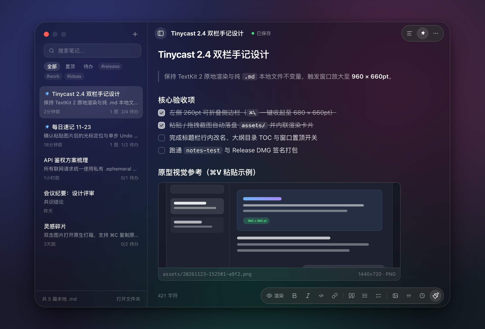
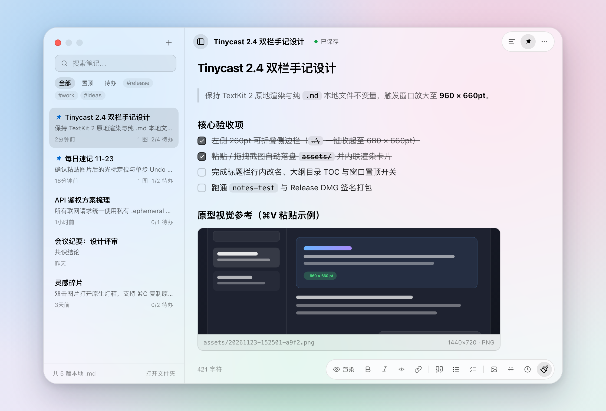
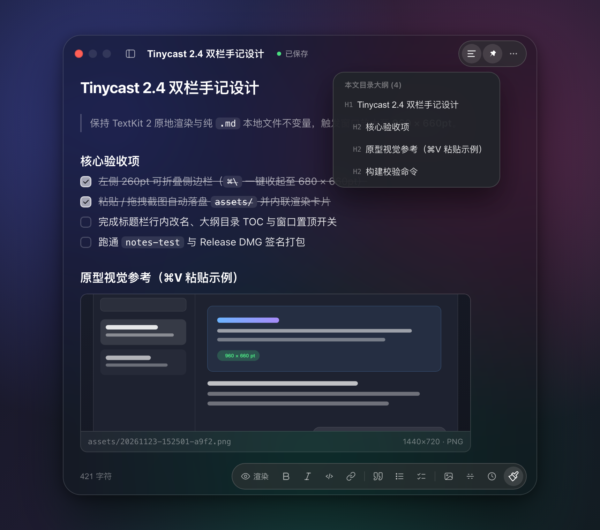

# Tinycast Notes · 双栏手记（版本 B）详细工程执行方案

> **目录位置**：`design/notes-split-workspace/`\
> **可交互原型**：[index.html](index.html)（支持 Safari / Chrome 直接打开，且支持真实 `⌘V` 粘贴剪贴板图片测试）\
> **视觉基线**：1:1 复刻「版本 B · 双栏手记」原型样式，触发默认尺寸放大至 **`960 × 660 pt`**（收起侧边栏为 **`680 × 660 pt`**），完整支持 **粘贴 / 拖拽图片** 与 TextKit 2 原地内联渲染。

---

## 1. 原型图附件与视觉总览

### 1.1 双栏工作台 · 深色模式（默认触发态 `960 × 660 pt`）



### 1.2 双栏工作台 · 浅色模式（`960 × 660 pt`）



### 1.3 收起侧边栏单窗模式 + 文档大纲 TOC（`680 × 660 pt`）



> **本地交互式预览方式**：直接在 Finder 双击打开 [index.html](index.html) 或在浏览器访问 `file:///.../design/notes-split-workspace/index.html`；支持点击顶部 `⌘V 模拟粘贴截图` 或直接用系统截图（`⌃⌘⇧4`）后在页面内按 **`⌘V`** 实时插入图片卡片、点击图片灯箱放大、点击 `#tag` 过滤侧边栏、点击 `⌘\` 折叠/展开侧边栏。

---

## 2. 设计原则与核心不变量约束

本方案严格遵守 Tinycast 既定架构红线（`AGENTS.md`、`docs/ui.md`、`docs/features/notes.md`）：

1. **纯本地 `.md` 存储不变量**：
   - 一篇笔记仍然对应 Notes 目录下的一份常规非隐藏 `.md` 文件，**不引入数据库、sidecar 文件或 YAML frontmatter**。
   - 置顶笔记列表（`notesPinnedFileNames`）、侧边栏展开状态（`notesSidebarVisible`）、窗口置顶状态（`notesAlwaysOnTop`）、底部统计维度（`notesStatsMode`）均为本地 UI 状态，写入 `UserDefaults`（按 `Bundle.main.bundleIdentifier` 隔离，确保 Debug 通道 `com.tinycast.app.dev` 与正式版互不污染）。
2. **`Features/Notes/Model/` 零 UI 框架依赖**：
   - `Tinycast/Features/Notes/Model/` 下所有文件**严禁** `import AppKit` / `import SwiftUI` / `import Cocoa`，全部值类型满足 `Sendable`、`Equatable`，供 `Tests/notes-test.swift` 直接编译验证。
3. **`AppCore` 唯一状态所有者**：
   - `AppCore` 持有 `NotesStore` 与 `NotesCoordinator`；视图层仅通过 `@Environment(NotesCoordinator.self)` 访问协调器，不直接接触 `AppCore` 或 `NotesStore`。
4. **TextKit 2 单一数据源（The storage is the source）**：
   - `NoteTextView.textStorage` 中的字符串始终与 `.md` 原文 100% 一致；图片、代码块、引用块、复选框等所有富媒体渲染**全部通过 `NSAttributedString` 属性与 `NoteBlockLayoutFragment` 绘制完成**，绝不使用 `NSTextAttachment` 插入非文本对象或维护第二套偏移映射，确保复制、撤销（`⌘Z`）、查找（`⌘F`）、输入法（marked text）与 Snippets 注入零偏差。
5. **弹窗与提示规范**：
   - 删除确认、冲突恢复等交互使用 `DialogController` / 内联恢复条 / `HUDPresenter`，**绝不使用 `NSAlert` 或系统原生 `NSPopover`**；面板内悬浮提示继续使用 Tinycast 自定义 `.tooltip(...)`。

---

## 3. 视觉规范与 1:1 复刻设计令牌（`Theme.swift` 变更清单）

### 3.1 窗口与组件尺寸令牌（替换/新增于 `Theme.Size`）

> 现行 `noteWindow` 为 `440 × 180 pt`（随正文高度伸缩，最大 `860 pt`），空间偏小且打开多图/长文时频繁抖动。按要求将双栏触发尺寸整体放大，同时废除会破坏双栏稳定性的自动缩高机制：

| Token 名称 | 原值 | 新值 | 用途说明 |
| --- | --- | --- | --- |
| `noteSplitWindow` | *(新增)* | `CGSize(width: 960, height: 660)` | 双栏展开时的首次触发默认尺寸 |
| `noteSplitMinimum` | *(新增)* | `CGSize(width: 760, height: 520)` | 双栏展开时的最小可拖拽尺寸 |
| `noteWindow` | `440 × 180` | `CGSize(width: 680, height: 660)` | 收起侧边栏后的单窗默认尺寸（原 `noteSingleWindow` 语义） |
| `noteSingleMinimum` | *(新增)* | `CGSize(width: 480, height: 440)` | 收起侧边栏后的最小可拖拽尺寸 |
| `noteSidebarWidth` | *(新增)* | `260` | 左侧可折叠笔记列表固定宽度（对齐原型的 `260pt`） |
| `noteTitlebar` | `52` | `52` | 保持 52pt 顶栏高度 |
| `noteTrafficLightInset` | `20` | `20` | 红绿灯距左边 20pt，与 `Radius.panel 26` 匹配 |
| `noteEditorInset` | `16` | `24` | 放大窗体后正文左右内边距增至 `24pt`，阅读呼吸感与原型一致 |
| `noteEditorTopInset` | `6` | `8` | 编辑器顶部与标题栏间距 |
| `noteSearchHeight` | `34` | `32` | 侧边栏搜索框高度 |
| `noteOutlineMenu` | *(新增)* | `CGSize(width: 240, height: 280)` | 标题大纲（TOC）悬浮窗最大尺寸（按行数动态收缩） |
| `noteActionsMenuWidth` | *(新增)* | `215` | 右上角 `⋯` 动作菜单宽度 |
| `noteImageMaxHeight` | *(新增)* | `260` | 编辑器内联图片最大展示高度（超过则等比缩放 / 裁剪，点击灯箱看原图） |
| `noteImageMaxWidth` | *(新增)* | `560` | 编辑器内联图片卡片最大宽度 |
| `noteImageCaptionHeight` | *(新增)* | `26` | 图片卡片底部相对路径与分辨率注脚栏高度 |
| `noteImageCornerRadius` | *(新增)* | `Theme.Radius.card` (`10`) | 卡片内连续圆角，与代码块圆角一致 |

> **窗口缩放与位置规则（`NotesWindowController` + `NoteWindowPlacement`）**：
> - 取消旧版 `fitToEditor()` 的每次输入重算窗高逻辑，改用固定可视区域滚动 + `setFrameAutosaveName("Notes Split Window")`，彻底消除长文/图片加载时的窗体跳动。
> - 点击 `⌘\` 或左上角侧边栏按钮时，**锚定窗口右边缘不动**（左侧向内收 `260pt` 变为 `680pt`，或向左展开 `260pt` 变为 `960pt`；若左边缘超出屏幕 `visibleFrame.minX`，则自动向右贴齐并夹紧在屏幕内）。动画时长遵守 `Motion.duration(Theme.Duration.enter)`，开启 Reduce Motion 或关闭 Show Animations 时瞬时完成。
> - 双击标题栏空白处仍然调用 `NoteWindowPlacement.topRight(...)` 吸附屏幕右上角。
> - **窗口置顶开关（`notesAlwaysOnTop`）**：默认 `true`（`panel.level = .floating`）；点击右上角大头针取消置顶后切换为 `.normal`，允许用户把笔记放到其他应用窗口后面而不遮挡工作区。

### 3.2 表面、色彩与圆角配方（1:1 对齐 `Theme.Colors` 与 `Theme.Radius`）

全部直接使用现有 `Theme.swift` 令牌，**不破坏 Dark 基线**：

| 界面元素 | Dark 表现（冻结基线） | Light 表现 | 代码令牌 |
| --- | --- | --- | --- |
| 窗口根底板 | 40% 黑 scrim + behind-window blur | 55% 白 scrim + behind-window blur | `Theme.Colors.panelScrim` + `GlassEffectView()` + `.clipShape(RoundedRectangle(cornerRadius: Theme.Radius.panel, style: .continuous))` |
| 左右分栏竖线 | 1pt `white 0.10` | 1pt `black 0.12` | `Theme.Colors.separator`（与 Clipboard / FileSearch 一致） |
| 侧边栏选中卡 | `white 0.10` | `black 0.09` | `Theme.Colors.selection`（圆角 `Theme.Radius.row 10`） |
| 侧边栏悬停卡 | `white 0.05` | `black 0.045` | `Theme.Colors.rowHover` |
| 侧边栏搜索框 / 图片卡底 | `white 0.05` + `white 0.10` 描边 | `black 0.04` + `black 0.10` 描边 | `Theme.Colors.cardFill` + `Theme.Colors.separator` |
| 标题栏 / 格式栏胶囊 | Liquid Glass 悬浮胶囊 | Liquid Glass 悬浮胶囊 | `.frosted(in: Capsule())` + `BarButton` |
| 目录 TOC / `⋯` 菜单浮窗 | 强模糊玻璃面板 | 强模糊玻璃面板 | `.glassEffect(.regular, in: RoundedRectangle(cornerRadius: Theme.Radius.menuPanel, style: .continuous))` |
| 正文文本 | `white 0.90` | `black 0.85` | `Theme.Colors.noteText` |
| 置顶标记 / `#tag` / 链接 | 系统蓝自适应色 | 系统蓝自适应色 | `Color.accentColor` / 系统 `.linkColor` |

---

## 4. 粘贴图片、拖拽与内联渲染专项架构

这是本次升级的核心增强能力，必须做到**存储干净、粘贴零摩擦、TextKit 2 不卡顿、安全不越界**。

### 4.1 本地存储规范（`NotesAssetStore`）

- **资产目录**：`<NotesDirectory>/assets/`（惰性创建，只有真正写入第一张图片时才 `createDirectory`）。
- **天然隔离现有列表**：`NotesRepository.list()` 只枚举 `notesDirectory` 下直接子级 `.md` 常规文件，天然忽略 `assets/` 子目录，**不会污染笔记列表，也不影响现有测试和导入/重定位逻辑**。
- **文件命名**：`yyyyMMdd-HHmmss-<4hex>.<ext>`（例如 `20261123-152501-a9f2.png`），防止同一秒内连续截图碰撞；若碰撞则递增后缀。
- **Markdown 写入格式**：单独成行写入标准相对路径：
  ```markdown
  
  ```
  与 Obsidian、Typora、GitHub、VS Code 100% 互通。
- **支持格式与编码策略**：
  - 系统截图 / 剪贴板位图（`public.png`, `public.tiff`, `NSImage`）：在后台 `Task.detached(priority: .utility)` 中转为 PNG 写入；若原图为透明通道缺失且像素面积超过阈值（如 > 2400px 宽），保留原尺寸无损 PNG 或提供可选压缩，确保 Retina 截图清晰。
  - 剪贴板/拖拽的本地图片文件 URL（`.png`, `.jpg`, `.jpeg`, `.webp`, `.gif`, `.heic`）：用 `CGImageSourceCreateWithURL` 验证文件头确实为合法图像后，原子拷贝（`writeNewFileAtomically`）进 `assets/`（保留原扩展名；若为 `.heic` 可直接存储或按需转码，macOS 26+ `CGImageSource` 原生支持解码 `.heic`/`.webp`）。
- **路径安全校验（`validatedAssetURL`）**：
  - 复用 `NotesRepository` 的安全校验思路：标准化路径 + `resolvingSymlinksInPath()`，严格限定必须在 `<NotesDirectory>/assets/` 之内（拦截 `../` 路径穿越与目录外符号链接），并禁止隐藏文件。

### 4.2 粘贴、拖拽与格式栏插入入口（`NoteTextView` + `NotesCoordinator`）

1. **剪贴板粘贴判定优先级（`NoteTextView.paste(_:)`）**：
   - ① 若当前 `rendersMarkdown == false`（纯文本模式）：走原生 `super.paste(sender)`。
   - ② 检查 `NSPasteboard.general` 是否包含**图片文件 URL** 或 **原始图像数据**（注意：从 Finder 复制图片文件时，剪贴板同时带文件 icon TIFF 和 `.fileURL`，**必须优先读取 `.fileURL` 并判断其 UTI 是否属于 `UTType.image`**，否则会把 Finder 图标当图片粘贴！若无图片 fileURL，再读取 `.png` / `.tiff` / `NSImage`）。
   - ③ 若非图片，检查是否满足现有 `pasteLink(from:)`（选区单行文字 + 剪贴板为 HTTP/HTTPS URL -> `[text](url)`）。
   - ④ 否则回落 `super.paste(sender)`。
2. **拖放接入（`NSDraggingDestination`）**：
   - `NoteTextView` 注册 `.fileURL`、`.png`、`.tiff`。拖入图片文件或浏览器图片时，在光标/落点所在行插入 Markdown 图片语法，并在拖拽悬停时展示细线插入指示器。
3. **格式栏 / `⋯` 菜单「插入图片」**：
   - 点击格式栏新增的图片图标（或 `⋯` 菜单「插入图片」），通过 `NSOpenPanel`（限定 `allowedContentTypes = [.image]`）选择本地图片文件后导入 `assets/` 并插入光标处（面板关闭后恢复焦点至 `NoteTextView`）。
4. **防异步陈旧（Stale Result）与单步 Undo**：
   - 写盘操作在 `Task.detached` 执行期间，捕获 `(expectedNoteID, expectedEpoch)`。
   - 写盘完成后切回 `@MainActor`：若用户已切换笔记、关闭功能或重置了 `editorEpoch`，立即放弃插入（或提示已保存至 `assets/`）。
   - 校验通过后，通过 `NoteTextView.performEdit(_:)` 在当前光标处原子插入换行 + `` + 换行，**天然纳入 AppKit 线性 Undo 栈（一次 `⌘Z` 即可撤回插入）并触发 300ms 防抖保存**。

### 4.3 TextKit 2 内联图片渲染方案

1. **语法解析（`Model/NoteMarkdownParser.swift`）**：
   - 新增行类型 `NoteMarkdown.Line.Kind.image(alt: String, destination: String)`。
   - 匹配独立成行的 ``（允许前后空白；支持 `assets/...` 相对路径及安全的本地子路径，不解析远端 `http(s)://` 自动外链拉取，严守隐私边界）。
   - `NoteTitle.swift` 同步跳过纯图片行，不把 `![...]` 当作未命名笔记的衍生标题；若整篇只有图片则回退显示 `[图片]` 或 `Untitled`。
2. **异步解码与缩略图缓存（`UI/NoteImageCache.swift`）**：
   - 使用 `@MainActor` + `NSCache<NSString, NSImage>`（设置 `totalCostLimit = 64 * 1024 * 1024` 字节上限），缓存键包含 `(noteDirectoryPath, relativePath, modificationDate, targetWidth)`。
   - 后台线程通过 `CGImageSourceCreateThumbnailAtIndex` 按最大显示宽度（`noteImageMaxWidth * backingScaleFactor`，约 `1120px`）生成缩略图，**避免把 4K/5K 原图整张解码常驻内存**。
   - 解码完成后回调主线程：仅对包含该图片路径的段落区间调用 `textLayoutManager?.invalidateLayout(for:)` 刷新高度。
3. **布局片段与视觉绘制（`UI/NoteBlockDecoration.swift` + `NoteBlockLayoutFragment.swift`）**：
   - `NoteBlockDecoration.Shape` 新增 `.image(path: String, alt: String, aspectRatio: CGFloat, state: ImageState)`。
   - **渲染态（光标不在该行）**：
     - 源码文字设为 `NoteMarkdownTypography.hidden` + `.clear`，`paragraphStyle` 保留底部 `Spacing.md` 间距。
     - `NoteBlockLayoutFragment` 根据 `containerWidth`（上限 `noteImageMaxWidth 560`）与图片真实宽高比计算展示框（高度上限 `noteImageMaxHeight 260`，留出底部 `26pt` 注脚栏显示 `assets/...` 与原始像素尺寸）。
     - 绘制流程：连续 `10pt` 圆角裁切 -> 绘制 `cardFill` 背景 -> 绘制图片（aspect fill 或 aspect fit 居中，保证不裁切关键截图文字，推荐 **aspect fit 居中 + 极淡暗底衬**）-> 绘制 `1px` `separator` 描边 -> 底部绘制半透明分割线与 `caption1` 字体路径/尺寸。
     - 若文件缺失或损坏，绘制优雅的虚线框占位卡片（`photo.badge.exclamationmark` + `找不到图片: assets/...`）。
   - **编辑态（光标落在该行时 Reveal）**：
     - **关键体验优化**：光标移入图片行时，上方显示灰阶源码 `` 供用户修改 `alt` 或路径，**但下方图片卡片预览依然保持绘制与高度占位（不塌缩）**！否则光标上下移动经过图片行时整个文档会剧烈跳动。
4. **交互与灯箱预览（`UI/NoteImagePreviewController.swift`）**：
   - **点击检测**：在 `NoteTextView.mouseDown` 中检测落点是否命中 `.image` 片段区域：
     - 单击图片卡片 -> 选中该图片行（并在右上角悬浮区响应「原图放大 / 复制图片 / 移除引用」操作，或直接高亮描边）。
     - 双击图片卡片 / 点击右上角「原图」按钮 -> 打开无激活边框的毛玻璃灯箱窗口 `NoteImagePreviewController`（按 `Space` / `Esc` 关闭，支持 `⌘C` 一键复制原图到剪贴板、`⌘O` 在 Finder 中显示原图文件）。
   - **删除引用与孤儿清理**：删除 `` 文本行时，**不自动删除磁盘图片**（防止用户在 `⌘Z` 撤销后图片丢失！）。在「打开文件夹」旁的更多菜单或设置中可按需提供「清理未引用图片（移入废纸篓）」动作。

---

## 5. 双栏工作台全模块架构与精确文件改动清单

### 5.1 Model 层（`Tinycast/Features/Notes/Model/` — 严格零 AppKit/SwiftUI 导入）

| 文件 | 操作 | 核心职责与变更 |
| --- | --- | --- |
| `NoteDocument.swift` | 修改 | `NoteSummary` 扩展 `preview: String?`、`tags: [String]`、`pendingTaskCount: Int`、`totalTaskCount: Int`、`imageCount: Int`；确保 `Equatable`、`Sendable` |
| `NoteMetadataExtractor.swift` | **新建** | 纯 Swift 扫描单篇笔记（单遍遍历）：提取首行摘要 `preview`、正文 `#tag` 去重列表、`- [ ]`/`- [x]` 待办计数、图片数，以及 H1–H3 标题大纲数组 `[NoteOutlineHeading]` |
| `NoteSidebarFilter.swift` | **新建** | 纯函数过滤与排序：`FilterKind`（`.all` / `.pinned` / `.tasks` / `.tag(String)`），置顶笔记永远排在最前且内部按 `modifiedAt` 降序，再接非置顶列表 |
| `NoteMarkdown.swift` | 修改 | `Line.Kind` 新增 `.image(alt: String, destination: String)` |
| `NoteMarkdownParser.swift` | 修改 | 支持独立行 `` 块级解析 |
| `NoteEditAction.swift` | 修改 | 新增 `.insertImage(alt: String, path: String)`、`.insertSnippet(text: String, caretOffset: Int)`（用于分割线 `---`、时间戳） |
| `NoteMarkdownEditing.swift` | 修改 | 实现 `.insertImage` 与 `.insertSnippet` 的 `NoteEditPlan` 规划；`formatting(of:)` 兼容图片行状态 |
| `NoteTitle.swift` | 修改 | `firstLine(of:)` 跳过图片行 ``，防止图片语法成为未命名笔记标题 |

### 5.2 Service 层（`Tinycast/Features/Notes/Service/`）

| 文件 | 操作 | 核心职责与变更 |
| --- | --- | --- |
| `NotesAssetStore.swift` | **新建** | 负责 `<NotesDirectory>/assets/` 读写与安全校验：粘贴图片数据编码（PNG）、文件 URL 校验与原子拷贝、文件名时间戳+随机后缀生成、图片尺寸读取（`CGImageSource`）、查找并移入废纸篓未引用孤儿图片 |
| `NotesRepository.swift` | 修改 | 1. `list()` 结合 `NoteMetadataExtractor` 提取摘要/标签/待办/图片数，并记录文件 `modifiedAt` 与 `contentHash`（SHA-256）；<br>2. 优化读取：仅对未命名的或需建索引文件读取头部/正文，且支持增量内存索引避免每次编辑全盘重读；<br>3. `save(id:source:expectedRevision:)` 支持对比磁盘 `mtime`/哈希，若检测到外部修改则抛出 `.conflict(diskSource:)` 错误而非静默覆盖 |
| `NotesStore.swift` | 修改 | 1. 暴露 `SaveState`（`.saved` / `.saving` / `.failed` / `.conflict(diskSource: String)`）；<br>2. 管理 `pinnedIDs: Set<NoteID>`（持久化回调注入 `AppCore`）与聚合 `availableTags: [String]`；<br>3. 提供 `resolveConflictKeepDraft()` 与 `resolveConflictLoadDisk()`；<br>4. 提供 `importImageData(_:)` / `importImageURL(_:)` 异步接口供 `NotesCoordinator` 调用 |

### 5.3 UI 层（`Tinycast/Features/Notes/UI/`）

| 文件 | 操作 | 核心职责与变更 |
| --- | --- | --- |
| `NotesPanel.swift` | 修改 | 支持 `setAlwaysOnTop(_: Bool)` 动态切换 `.floating` / `.normal`；新增 `⌘\`、`⌥⌘O`（大纲）、`⌥⌘P`（置顶切换）、`⇧⌘C`（复制 Markdown）快捷键分发 |
| `NotesWindowController.swift` | 修改 | 1. 改为 `960 × 660 pt`（展开）与 `680 × 660 pt`（收起）双栏 autosave（`"Notes Split Window"`），移除 `fitToEditor()`；<br>2. 实现侧边栏展开/收起时右边缘锚定的宽度平滑过渡动画；<br>3. 支持程序化滚动定位到指定字符/行偏移（供目录大纲跳转高亮）；<br>4. 统筹 `NoteImagePreviewController` 灯箱与 `NSOpenPanel` 选图回调后的焦点恢复 |
| `NotesCoordinator.swift` | 修改 | 1. 管理 `isSidebarVisible`、`isAlwaysOnTop`、`sidebarFilter`、`activeTag`、`statsDisplayMode`、`isOutlinePresented`、`isMoreMenuPresented`、`isRenamingTitle`；<br>2. 协调 `pasteImage` / `dropImage` / `pickImage` 流程并校验 `(activeID, editorEpoch)` 防陈旧；<br>3. 响应正文中 `#tag` 点击直接联动过滤侧边栏；<br>4. 保留旧版 `NoteSwitcherWindowController` 仅作可选回退或在全键盘 `⌘P` 时聚焦左侧边栏搜索框（避免两套搜索 UI 冲突） |
| `NotesView.swift` | 修改 | 1:1 复刻原型双栏布局：`HStack(spacing: 0)` 包裹可选 `NoteSidebarView`（`260pt`）+ `1pt` `Theme.Colors.separator` 竖线 + 右侧编辑区（`NoteEditorHeaderView` + `NoteEditorView` + 底部 `NoteFormattingBar`）；处理外部冲突内联提示条 |
| `NoteSidebarView.swift` | **新建** | 1:1 复刻原型左侧栏：红绿灯 + `+` 新建按钮 -> `32pt` 圆角搜索框 -> `全部 / 置顶 / 待办` 胶囊与 `#tag` 标签云 -> 滚动笔记卡片列表（置顶图标、1行摘要、时间、`N 图`、`done/total 待办`、悬停置顶按钮） -> 底部总数与「打开文件夹」 |
| `NoteEditorHeaderView.swift` | **新建** | 1:1 复刻原型右栏 `52pt` 顶栏：折叠按钮（`⌘\`）+ 可点击行内重命名标题 + 保存状态圆点（已保存/保存中/外部有修改）；右侧 Liquid Glass 胶囊（`目录 TOC`、`窗口置顶 Pin`、`更多 ⋯`） |
| `NoteOutlinePopoverView.swift` | **新建** | 悬浮玻璃目录浮窗（`H1/H2/H3` 缩进渲染），点击调用 `NotesCoordinator.jumpToHeading(lineIndex:)` 滚动并短暂高亮目标标题 |
| `NoteActionsMenuView.swift` | **新建** | 右上角 `⋯` 悬浮玻璃菜单：复制为 Markdown (`⇧⌘C`)、复制为纯文本、插入图片、在 Finder 中显示 (`⌘O`)、清理未引用图片、移到废纸篓 (`⌘⌫`) |
| `NoteTextView.swift` | 修改 | 重写 `paste(_:)` 支持图片粘贴、接入 `NSDraggingDestination` 拖拽图片、点击检测图片卡片区域（单击选中/悬停动作、双击打开灯箱） |
| `NoteEditorView.swift` | 修改 | 传递 `notesDirectory` 给 `NoteImageCache`、新增滚动定位与高亮回调、更新 `textContainerInset` 为 `24pt` |
| `NoteMarkdownRenderer.swift` & `NoteMarkdownStyler.swift` | 修改 | 识别 `.image` 行类型并绑定 `NoteBlockDecoration.Shape.image`；支持正文内 `#tag` 视觉染色与点击跳转；支持代码块右上角「复制」交互区命中 |
| `NoteBlockDecoration.swift` & `NoteBlockLayoutFragment.swift` | 修改 | 新增图片卡片绘制（连续 10pt 圆角、等比居中图片、缺失占位、底部文件路径与尺寸注脚）及动态行高测量（Reveal 源码时下方图片不塌缩） |
| `NoteImageCache.swift` | **新建** | 异步 `CGImageSource` 缩略图解码 + `NSCache` 64MB 内存缓存 + 目录变更失效 |
| `NoteImagePreviewController.swift` | **新建** | 非激活玻璃灯箱面板，支持看原图、放大查看、复制原图 (`⌘C`)、Finder 定位 (`⌘O`) 与 `Esc` 关闭 |
| `NoteFormattingBar.swift` | 修改 | 1:1 复刻原型底部格式胶囊：新增 `渲染 / Raw` 切换按钮、`插入图片` 按钮、`分割线 ---` 与 `时间戳` 按钮；左下角字数统计支持点击循环切换（字符数 -> 词数与阅读时长 -> 待办与图片数） |

### 5.4 App 组合根与配置（`AppCore.swift`、`Theme.swift`、`project.yml`）

- `Theme.swift`：写入 3.1 节全部尺寸令牌。
- `AppCore.swift`：新增本地 UI 状态持久化键（`notesSidebarVisible` 默认 `true`、`notesAlwaysOnTop` 默认 `true`、`notesPinnedFileNames`、`notesStatsMode`），均不进 `SettingsBackup` 和 `settings.json`。
- `project.yml`：运行 `xcodegen generate` 自动纳入新建的 `.swift` 文件并提交更新后的 `Tinycast.xcodeproj`。
- `Localizable.xcstrings`：所有新增中文/英文交互文案使用 `String(localized:)` 声明，执行 `./Scripts/sync-strings.sh` 并补齐 8 种语言翻译。

### 5.5 完整快捷键矩阵

| 快捷键 | 作用域 | 动作 |
| --- | --- | --- |
| `⌘\` | Notes 面板 | 展开 / 收起左侧边栏（`960×660` ↔ `680×660`） |
| `⌘N` | Notes 面板 | 新建空白 `.md` 笔记并自动展开聚焦编辑区 |
| `⌘P` / `⇧⌘F` | Notes 面板 | 若侧边栏收起则自动展开，并直接聚焦侧边栏搜索框 |
| `⌥⌘O` | Notes 面板 | 打开 / 关闭当前笔记的目录大纲 TOC 浮窗 |
| `⌥⌘P` | Notes 面板 | 切换当前笔记置顶（Pin）状态 |
| `⌥⌘T` | Notes 面板 | 展开 / 收起底部格式工具栏胶囊 |
| `⌥⌘R` | Notes 面板 | 切换 `Markdown 渲染` ↔ `纯源码 Raw` 视图 |
| `⌘V` | 编辑区聚焦 | 若剪贴板含图片/截图 -> 自动落盘 `assets/` 并插入；URL -> 覆选成链；否则原生粘贴 |
| `⇧⌘C` | Notes 面板 | 复制当前笔记完整 Markdown 源码到剪贴板并弹 HUD |
| `⌘F` | 编辑区聚焦 | 打开 AppKit 原生查找条 |
| `⌘O` | Notes 面板 | 在 Finder 中选中当前 `.md` 文件 |
| `⌘W` / `Esc` | Notes 面板 | 依次关闭：灯箱 -> 大纲/更多菜单 -> 重命名框 -> 查找条 -> 隐藏 Notes 面板并还原焦点 |

---

## 6. 分阶段实施计划（Phase 1 – Phase 4）

### Phase 1：Model 层与纯逻辑基建（零 UI 风险）
- [ ] 更新 `Theme.swift` 尺寸令牌（`960×660`、`680×660`、`260` 侧边栏、图片尺寸边界）。
- [ ] 实现 `NoteMetadataExtractor.swift`、`NoteSidebarFilter.swift`，扩展 `NoteDocument.swift`、`NoteMarkdown.swift`、`NoteMarkdownParser.swift`（图片行解析）、`NoteEditAction.swift`、`NoteMarkdownEditing.swift`（插图与片段插入）、`NoteTitle.swift`。
- [ ] 在 `Tests/notes-test.swift` 补充完整单元测试：图片语法解析、边界路径拦截、`#tag` 与待办提取、侧边栏置顶排序、H1–H3 大纲提取。
- **阶段验收**：`./Scripts/run-tests.sh`（或单独编译运行 `notes-test`）全绿，且 `grep -rln 'import AppKit\|import SwiftUI\|import Cocoa' Tinycast/Features/*/Model/` 输出为空。

### Phase 2：本地资产存储与安全存储层（`Service/`）
- [ ] 实现 `NotesAssetStore.swift`（剪贴板/文件 URL 校验、`assets/` 原子写入、时间戳+4位随机命名、安全路径检查、孤儿资产扫描与废纸篓清理）。
- [ ] 升级 `NotesRepository.swift` 与 `NotesStore.swift`（增量元数据索引、置顶状态同步、外部修改冲突检测与恢复接口）。
- [ ] 在 `Tests/notes-test.swift` 增加 `NotesAssetStore` 路径穿越拦截测试、图片导入去重测试、外部修改冲突触发与双分支恢复测试。
- **阶段验收**：`notes-test` 全量通过；无竞态与孤立读写警告。

### Phase 3：1:1 双栏 UI、粘贴图片与 TextKit 2 内联渲染（`UI/`）
- [ ] 实现 `NoteImageCache.swift` 与 `NoteBlockLayoutFragment.swift` 图片卡片绘制（圆角卡片、等比缩放、缺失占位、Reveal 源码不塌缩）、`NoteImagePreviewController.swift` 原图灯箱。
- [ ] 实现 `NoteTextView.swift` 的图片粘贴（区分 Finder 文件图标与真实图片）、拖放导入、图片单击/双击命中、代码块复制命中、`#tag` 点击响应。
- [ ] 实现 `NoteSidebarView.swift`、`NoteEditorHeaderView.swift`、`NoteOutlinePopoverView.swift`、`NoteActionsMenuView.swift`，改造 `NotesView.swift`、`NoteFormattingBar.swift`、`NotesWindowController.swift`、`NotesCoordinator.swift` 与 `AppCore.swift`。
- [ ] 补全 `Tests/notes-editor-test.swift`（图片插入单步 Undo、图片行 Reveal 渲染、Raw 切换、大纲跳转）与 `Tests/notes-editor-performance.swift`（100k 字符 + 20 张缓存缩略图滚动与输入延迟测试）。
- **阶段验收**：对照 `prototype-split-dark.png`、`prototype-split-light.png`、`prototype-collapsed-dark.png` 逐像素核对双外观（在亮色壁纸下测试圆角与毛玻璃边缘）。

### Phase 4：国际化、文档同步与最终打包交付
- [ ] 运行 `./Scripts/sync-strings.sh`，在 `Tinycast/Resources/Localizable.xcstrings` 中补齐全部新增词条的 8 种语言翻译。
- [ ] 运行 `xcodegen generate` 更新项目文件，更新 `docs/features/notes.md` 与 `docs/ui.md` 中的窗口尺寸、双栏结构与图片存储说明。
- [ ] 执行完整质量闸门：
  - `./Scripts/run-tests.sh` 全部通过
  - `./Scripts/lint.sh` 零错误/零警告
  - Debug 构建零新增编译器警告
- [ ] 按 `docs/release.md#required-local-completion` 构建签名 Release DMG、备份本地已安装应用、替换并重启验证真实运行进程与版本号。

---

## 7. 关键技术风险与避坑清单

1. **Finder 复制文件时的剪贴板陷阱**：
   - 从 Finder 按 `⌘C` 复制一张 `.png` 文件时，`NSPasteboard` 会同时写入 `public.file-url` 和 Finder 文件缩略图 `public.tiff`。如果不优先判断 `.fileURL` 是否指向合法图片文件，用户粘贴进去的将是模糊的 Finder 图标而非原图。**解法**：永远先读取文件 URL 并检查 `UTType.image`；仅当无图片文件 URL 时才读取原始位图流。
2. **TextKit 2 图片行在 Reveal 时跳动**：
   - 普通行内语法（如 `**粗体**`）光标移入时只显示 `**`，行高几乎不变；但图片行如果光标移入就隐藏图片或大幅改变行高，会导致整个滚动视图瞬间跳动甚至把用户光标挤出视口。**解法**：图片行选中时在顶部留出 `22pt` 显示灰阶源码 ``，下方图片绘制框保持原地占位不塌缩。
3. **非激活面板（`nonactivatingPanel`）下的系统选图弹窗焦点**：
   - 触发 `NSOpenPanel` 选图会短暂激活系统面板；结束后若用户仍在 Tinycast 场景中，需显式 `panel.makeKeyAndOrderFront(nil)` 并重设 `firstResponder` 至 `NoteTextView`，同时保留原有的 `previousApp` 以便 `⌘W` 时仍能准确归还焦点。
4. **大图 Retina 截图的内存暴涨**：
   - MacBook Pro 上截一张全屏截图通常是 `3024×1964` 或更高分辨率；若直接把 `NSImage(contentsOf:)` 塞进缓存，10 张图就会占用数百 MB 内存。**解法**：`NoteImageCache` 统一通过 `CGImageSourceCreateThumbnailAtIndex` 按 `min(原图宽, 560 * scale)` 后台降采样，仅在用户双击打开灯箱时按需加载全尺寸原图，关闭灯箱即释放原图引用。
